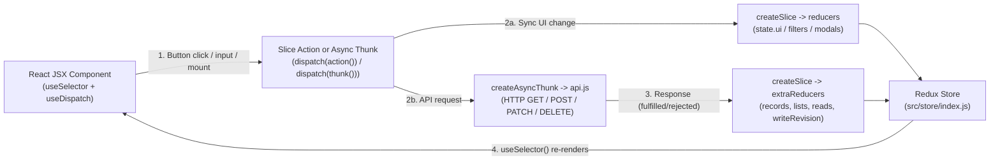

# CareerNest Redux Workflow & UI Data-Rendering Guide

This guide explains how every screen, card, table, modal, and button in the React frontend renders from and updates the **Redux Toolkit store** (`useSelector`, `useDispatch`, `createSlice`, `reducers`, `actions`, and `createAsyncThunk` thunks).

---

## 1. Overall End-to-End Architecture

### Core Building Blocks
1. **Store Configuration** — [`src/store/index.js`](src/store/index.js)
   - Combines all **23 slices** inside `appReducer`.
   - `rootReducer` watches `state.auth.workspaceVersion` and automatically resets role/domain state (while keeping `auth` and `publicPages`) whenever a user signs in, signs out, or switches accounts.
   - Hydrates the initial session on startup via `store.dispatch(setSession(readSession()))`.
2. **HTTP Client & Session Auth** — [`src/services/api.js`](src/services/api.js)
   - Shared `axios` instance (`api`) pointing to `VITE_API_BASE_URL` (default `http://localhost:3000`).
   - Request interceptor attaches `Authorization: Bearer <token>`, `x-user-id`, `x-role`, and `x-college-id` from `readSession()`.
   - Response interceptor handles `401` session expiration and redirects to `/login`.
3. **Router & Session Sync** — [`src/app/AppRouter.jsx`](src/app/AppRouter.jsx)
   - Listens to `storage`, `pageshow`, and `popstate` events and dispatches `setSession(readSession())` directly to `authSlice`.

---

## 2. How UI Data Renders from Redux (Step-by-Step)

1. **On Mount (`useEffect`)**:
   - A workspace shell (e.g., `CandidateApp`, `AlumniApp`, `RecruiterApp`, `PlacementApp`, `CollegeAdminApp`, `SuperAdminApp`) or page component calls `dispatch(load...())` / `dispatch(fetch...())`.
2. **Inside the Thunk (`createAsyncThunk`)**:
   - The thunk calls `api.get(...)` / `api.post(...)` / `api.patch(...)` / `api.delete(...)`.
   - On success, it returns the payload; on failure, it returns `rejectWithValue(serializeApiError(error))`.
3. **Inside the Slice (`extraReducers`)**:
   - `.pending` updates loading/request tracking (`reads[key]`).
   - `.fulfilled` writes normalized records into `state.records[id]` and ordered IDs into `state.lists[key]`.
   - `.rejected` stores the error message.
4. **Rendering in JSX (`useSelector`)**:
   - Components read data with `useSelector(selector)` (e.g., `selectCandidateStore`, `selectOfficerData`, `selectUsersDirectory`, `selectLandingContent`).
   - Whenever the Redux state updates, React automatically re-renders the UI from the new store state.
5. **User Interactions (`useDispatch`)**:
   - Every button click, tab switch, search input, filter dropdown, modal open/close, and form submit calls `dispatch(action(...))` directly in JSX.
   - **Ctrl + Click** on any dispatched action in JSX jumps directly to its reducer or thunk in `src/store/slices/`.

---

## 3. Complete Slice Inventory (`src/store/slices/`)

### A. Core & Public Slices
| Store Key | File | Purpose & State |
|---|---|---|
| `auth` | [`src/store/slices/authSlice.js`](src/store/slices/authSlice.js) | Session (`user`, `workspaceVersion`), `signIn`, `logoutUser`, `updateSessionUser`, `loginForm` UI state, `changePasswordUi` state |
| `publicPages` | [`src/store/slices/publicSlice.js`](src/store/slices/publicSlice.js) | Theme (`dark`/`light`), `landingContent` (all landing page cards/FAQs/stats/roles), navbar scroll, hero slide index, feature role tab, FAQ accordion, stats animation, newsletter, recruiter contact form |
| `dialogs` | [`src/store/slices/dialogSlice.js`](src/store/slices/dialogSlice.js) | Global confirmation/info dialog state (`openDialog`, `dismissDialog`) |

### B. Domain Entity Slices (Backend API ↔ Store)
| Store Key | File | Backend Endpoints & Owned Data |
|---|---|---|
| `users` | [`src/store/slices/usersSlice.js`](src/store/slices/usersSlice.js) | `/users`, `/users/:id`, `/users/oversight`, `/users/alumni-directory`, `/features/officer/candidates/filter`, `/features/alumni/directory`, `/users/import-students`, `/users/import-alumni`, `/users/:id/password`, plus `directoryUi` & `csvImportUi` |
| `opportunities` | [`src/store/slices/opportunitiesSlice.js`](src/store/slices/opportunitiesSlice.js) | `/opportunities` (fetch, create, update, delete, approve, reject, publish, undo approval) |
| `applications` | [`src/store/slices/applicationsSlice.js`](src/store/slices/applicationsSlice.js) | `/applications` (fetch, my applications, apply, withdraw, update status, bulk shortlist, fetch resume blob) |
| `assessments` | [`src/store/slices/assessmentsSlice.js`](src/store/slices/assessmentsSlice.js) | `/assessments` (fetch workspace assessments, my assessments, schedule, delete) |
| `referrals` | [`src/store/slices/referralsSlice.js`](src/store/slices/referralsSlice.js) | `/referrals` (fetch received/my referrals, create request, approve/decline response, fetch resume blob) |
| `savedDrives` | [`src/store/slices/savedDrivesSlice.js`](src/store/slices/savedDrivesSlice.js) | `/saved-drives` (fetch, save, unsave) |
| `notifications` | [`src/store/slices/notificationsSlice.js`](src/store/slices/notificationsSlice.js) | `/notifications` (fetch inbox, mark one read, mark all read) |
| `notificationDeliveries` | [`src/store/slices/notificationDeliveriesSlice.js`](src/store/slices/notificationDeliveriesSlice.js) | `/notifications/bulk` (fetch sent bulk notifications, send bulk notification) |
| `announcements` | [`src/store/slices/announcementsSlice.js`](src/store/slices/announcementsSlice.js) | `/announcements` (fetch, create, delete) |
| `colleges` | [`src/store/slices/collegesSlice.js`](src/store/slices/collegesSlice.js) | `/colleges` (public list, platform colleges, single college, create, update status) |
| `recruiterRegistrations` | [`src/store/slices/recruitersSlice.js`](src/store/slices/recruitersSlice.js) | `/recruiters` (contact form submit, list registrations, approve, decline, delete) |
| `messages` | [`src/store/slices/messagesSlice.js`](src/store/slices/messagesSlice.js) | `/messages` (inbox messages, sent messages, send admin message) |
| `activityEntries` | [`src/store/slices/activitySlice.js`](src/store/slices/activitySlice.js) | `/activity` (officer activity log, platform activity log) |
| `resources` | [`src/store/slices/resourcesSlice.js`](src/store/slices/resourcesSlice.js) | Oversight validation policy (`oversightPolicy`), officer placement stats (`officerPlacement`), super admin platform stats (`platformStats`) |

### C. Role Workspace Slices (Selectors + Page/Modal/Filter UI State)
| Store Key | File | Owns UI & Derived View State For |
|---|---|---|
| `candidate` | [`src/store/slices/candidateSlice.js`](src/store/slices/candidateSlice.js) | `CandidateApp`, `Layout`, `GlobalModals`, `Dashboard`, `Opportunities`, `SavedDrives`, `Applications`, `ApplicationTracker`, `Referrals`, `Profile` (including toast, sign-out modal, multi-step apply modal, profile modals, and `selectCandidateStore`) |
| `alumni` | [`src/store/slices/alumniSlice.js`](src/store/slices/alumniSlice.js) | `AlumniApp`, `Sidebar`, `AlumniNotifications`, `AlumniDashboard`, `AlumniDirectory`, `AlumniProfile`, `ReferralRequests`, `ResumeModal`, `DeclineModal` |
| `recruiter` | [`src/store/slices/recruiterSlice.js`](src/store/slices/recruiterSlice.js) | `RecruiterApp`, `Navbar`, `Sidebar`, `Dashboard`, `PostOpportunity`, `MyOpportunities`, `OpportunityEditor`, `OpportunityFields`, `Applications`, `CandidateModal`, `CandidatesFilter`, `Assessments`, `ScheduleModal`, `HiringReport`, `Profile` |
| `placementOfficer` | [`src/store/slices/placementOfficerSlice.js`](src/store/slices/placementOfficerSlice.js) | `PlacementApp`, `Sidebar`, `Header`, `Dashboard`, `ReviewOpportunities`, `Statistics`, `Recruiters`, `UserOversight`, `AppTracking`, `BulkNotify`, `CandidatesFilter`, `Profile` |
| `collegeAdmin` | [`src/store/slices/collegeAdminSlice.js`](src/store/slices/collegeAdminSlice.js) | `CollegeAdminApp`, `Sidebar`, `Topbar`, `Dashboard`, `Officers`, `Recruiters`, `ActivityLog`, `Announcements`, `Messages`, `Reports`, `Profile` |
| `superAdmin` | [`src/store/slices/superAdminSlice.js`](src/store/slices/superAdminSlice.js) | `SuperAdminApp`, `Sidebar`, `Topbar`, `Dashboard`, `Colleges`, `CollegeAdmins`, `ActivityLog`, `Messages`, `Profile` |

---

## 4. Actor-by-Actor UI → Redux → Backend Examples

### 1. Public Landing & Login
- **Landing Content**: `CoreFeatures.jsx`, `Problem.jsx`, `Process.jsx`, `Roles.jsx`, `Testimonals.jsx`, `Features.jsx`, `FAQ.jsx`, `Hero.jsx`, `Stats.jsx` read `useSelector(selectLandingContent)` from `publicSlice.js`.
- **Feature Role Tabs**: Clicking a role tab in `Features.jsx` dispatches `selectFeatureRole(role.id)` → updates `state.publicPages.activeFeatureRole`.
- **Recruiter Contact Form**: `ContactSection.jsx` loads colleges via `dispatch(fetchPublicColleges())`, binds inputs to `setContactField`, and submits via `dispatch(submitRecruiterContact(payload))` (`POST /recruiters/contact`).
- **Login**: `LoginPage.jsx` binds inputs to `setLoginEmail` / `setLoginPassword` and signs in with `dispatch(signIn({ email, password }))` (`POST /users/login`), which saves the session and sets `state.auth.user`.

### 2. Candidate
- **Workspace Load**: `CandidateApp.jsx` dispatches `loadCandidateSnapshot({ workspaceVersion })`, which runs parallel thunks (`fetchUserById`, `fetchOpportunities`, `fetchMyApplications`, `fetchNotifications`, `fetchSavedDrives`, `fetchMyAssessments`, `fetchMyReferrals`, `fetchAnnouncements`).
- **Rendering**: Every candidate page reads `useSelector(selectCandidateStore)`.
- **Actions**:
  - `Opportunities.jsx`: `setOpportunityQuery`, `setOpportunityTypeFilter`, `openOpportunityApplyModal`, `dispatch(applyToJob(...))` (`POST /applications`), `dispatch(saveDrive(...))` / `dispatch(unsaveDrive(...))`.
  - `Applications.jsx`: `setApplicationsFilter`, `withdrawCandidateApplication` (`PATCH /applications/:id`), `openApplicationReferralModal`, `requestCandidateReferral` (`POST /referrals`).
  - `SavedDrives.jsx`: `unsaveDrive(jobId)` + `showCandidateToast(...)`.

### 3. Alumni
- **Workspace Load**: `AlumniApp.jsx` dispatches `fetchUserById(session.id)` and `fetchReferrals()`.
- **Rendering**: `useSelector(selectAlumni)` combines current user + received referrals.
- **Actions**:
  - `ReferralRequests.jsx`: `setReferralsFilter`, `openResumeModal(r.id)` (`fetchReferralResume`), `respondToReferral` (`PATCH /referrals/:id`), `openDeclineModal(r.id)`.
  - `AlumniDirectory.jsx`: `fetchAlumniDirectory()` + `setDirectorySearchQuery`, `setDirectoryBatch`, `setDirectoryDept`.

### 4. Recruiter
- **Workspace Load**: `RecruiterApp.jsx` dispatches `loadRecruiterWorkspace({ workspaceVersion })` (`fetchOpportunities`, `fetchApplications`, `fetchAssessments`, `fetchNotifications`).
- **Actions**:
  - `PostOpportunity.jsx`: `setPostOpportunityField`, `resetPostOpportunityForm`, `createOpportunity` (`POST /opportunities`).
  - `MyOpportunities.jsx` & `OpportunityEditor.jsx`: `setMyOpportunitiesEditingId`, `updateOpportunity` (`PATCH /opportunities/:id`), `deleteOpportunity` (`DELETE /opportunities/:id`).
  - `Applications.jsx` & `CandidateModal.jsx`: `setRecruiterSelectedCandidateId`, `updateApplicationStatus` (`PATCH /applications/:id`), `fetchApplicationResume`.
  - `CandidatesFilter.jsx`: `bulkUpdateApplications` (`PATCH /applications/bulk`).
  - `Assessments.jsx` & `ScheduleModal.jsx`: `createAssessment` (`POST /assessments`), `deleteAssessment` (`DELETE /assessments/:id`).

### 5. Placement Officer
- **Workspace Load**: `PlacementApp.jsx` dispatches `loadOfficerData({ workspaceVersion })` (`fetchOpportunities`, `fetchApplications`, `fetchOversightUsers`, `fetchRecruiterRegistrations`, `fetchAssessments`, `fetchOfficerPlacement`, `fetchAnnouncements`, `fetchNotifications`).
- **Rendering**: `useSelector(selectOfficerData)` computes dashboard KPIs, branch stats, submissions, recruiters, and applications.
- **Actions**:
  - `ReviewOpportunities.jsx`: `approveOpportunity`, `publishOpportunity`, `rejectOpportunity`, `undoOpportunityApproval`.
  - `Recruiters.jsx`: `approveRecruiter`, `declineRecruiter`.
  - `BulkNotify.jsx`: `sendBulkNotification` (`POST /notifications/bulk`).

### 6. College Admin
- **Workspace Load**: `CollegeAdminApp.jsx` dispatches `refreshCollegeAdminData()` (`fetchCollegeById`, `fetchUsers` for `placement_officer` / `candidate` / `alumni`, `fetchApplications`).
- **Students & Alumni (`AccountDirectory.jsx`)**:
  - `+ Add Student / Alumni` → `dispatch(openAddUserModal())` → form submit calls `dispatch(createUser(...))` (`POST /users`).
  - `Import CSV` → `dispatch(openCsvImportModal())` → `dispatch(importUsers(...))` (`POST /users/import-students` or `/users/import-alumni`).
  - `Remove` → `dispatch(deleteUser(id))` (`DELETE /users/:id`).
- **Officers / Announcements / Recruiters**: `createPlacementOfficer`, `updatePlacementOfficerStatus`, `createAnnouncement`, `deleteAnnouncement`, `deleteRecruiter`.

### 7. Super Admin
- **Workspace Load**: `SuperAdminApp.jsx` dispatches `refreshSuperAdminData()` (`fetchPlatformColleges`, `fetchPlatformStats`, `fetchUsers('placement_officer')`).
- **Actions**:
  - `Colleges.jsx`: `createCollege` (`POST /colleges`), `updateCollegeStatus` (`PATCH /colleges/:id/status`).
  - `CollegeAdmins.jsx`: `assignCollegeAdmin` (`POST /users/college-admin`), `updateCollegeAdminStatus`.
  - `Messages.jsx`: `sendAdminMessage` (`POST /messages`), `fetchSentMessages`.
  - `ActivityLog.jsx`: `fetchPlatformActivity`.
